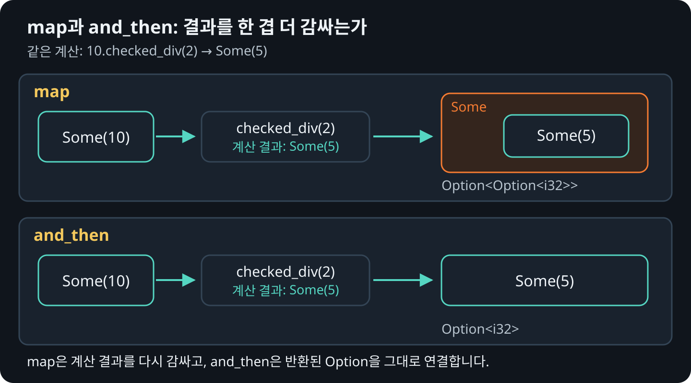

# `Option` 안의 값 바꾸고 대체값 구하기

이 장에서는 `Some` 안의 값을 바꾸거나 조건에 따라 제외한 뒤, 값이 `None`일 때
`or_else`로 다른 곳에서 대체값을 구하는 방법을 살펴봅니다.

## match에서 map으로

다음 코드는 `Some` 안의 값에 계산을 적용하고, `None`이면 그대로 반환합니다.

```rust
{{#rustdoc ../../../examples/03_transform.rs item=double_with_match}}
```

`map`을 쓰면 같은 동작을 더 짧게 표현할 수 있습니다. `|value| value * 2`는 값을 받아 계산하는
클로저<sub>closure</sub>입니다. `Some`일 때만 그 안의 값을 받아 실행됩니다.

```rust
{{#rustdoc ../../../examples/03_transform.rs item=double_with_map}}
```

## 다음 계산도 Option을 반환할 때

`checked_div`는 Rust 정수 타입에 기본으로 있는 메서드입니다.
`value.checked_div(divisor)`는 나눗셈이 가능하면 `Some(몫)`을 반환하고,
0으로 나누거나 결과가 정수 타입의 범위를 벗어나면 `None`을 반환합니다.

다음은 `i32::checked_div`의 동작을 이해하기 위해 풀어 쓴 학습용 구현입니다.
표준 라이브러리의 소스를 그대로 옮긴 것은 아닙니다.

```rust
{{#rustdoc ../../../examples/03_transform.rs item=checked_div_example}}
```

`i32::MIN`은 `i32`의 최솟값입니다. 이 값을 `-1`로 나누면 결과가
`i32`의 최댓값보다 1 커지므로 이 경우에도 `None`을 반환합니다.
예를 들어 `10_i32.checked_div(2)`는 `Some(5)`,
`10_i32.checked_div(0)`은 `None`입니다.

이 계산을 `map`으로 실행하면 결과가 `Option<Option<i32>>`로 한 겹 더 감싸집니다. `and_then`을 쓰면
계산 결과를 다시 감싸지 않고 `Option<i32>`로 받을 수 있습니다.

```rust
{{#rustdoc ../../../examples/03_transform.rs item=transform}}
```

## 두 결과의 모양 비교하기

<figure>
  
  <figcaption>같은 함수를 넘겨도 map은 결과를 다시 감싸고, and_then은 그대로 연결합니다.</figcaption>
</figure>

## 조건에 맞는 값만 남기기

`filter`는 `Some` 안의 값이 조건에 맞지 않으면 `None`을 반환합니다.
조건을 검사하는 함수에는 값의 참조를 넘깁니다.

```rust
{{#rustdoc ../../../examples/03_transform.rs body=alternatives}}
```

## `or_else`로 기본값 정하기

서버의 포트 번호를 사용자가 지정할 수도 있고, 생략할 수도 있다고 해 봅시다.
지정한 값이 있으면 그대로 쓰고, 없으면 기본 포트인 `3000`을 사용하려고 합니다.

`or_else`는 원래 값이 `Some`이면 그대로 반환하고, `None`일 때만 클로저를
실행합니다. 이 클로저는 대신 사용할 `Option`을 반환해야 합니다.

```rust
{{#rustdoc ../../../examples/03_transform.rs item=default_with_or_else}}
```

`port`가 `Some(8080)`이면 결과는 `Some(8080)`이고, `None`이면
`Some(3000)`입니다. `|| Some(3000)`은 인자 없이 기본값을 담은 `Option`을
만드는 클로저입니다. 결과도 여전히 `Option<u16>`이라는 점에 주목하세요.

다만 `3000`처럼 계산할 필요가 없는 고정값이라면 `port.or(Some(3000))`으로
더 간단히 쓸 수 있습니다. `or_else`는 다른 설정을 읽거나 문자열을 숫자로
바꾸는 등, 대체값을 구하는 작업을 필요할 때만 실행하려는 경우에 잘 어울립니다.

## 다른 설정에서도 값을 구하지 못할 수 있을 때

사용자가 포트를 지정하지 않았다면 설정 문자열에서 포트 번호를 구해 봅시다.
`parse::<u16>()`은 문자열을 숫자로 바꾸고, `.ok()`는 변환에 성공하면
`Some(숫자)`, 실패하면 `None`으로 바꿉니다.

```rust
{{#rustdoc ../../../examples/03_transform.rs item=port_from_settings}}
```

| 사용자가 지정한 포트 | 설정 문자열 | 결과 |
| --- | --- | --- |
| `Some(8080)` | `"4000"` | 설정 문자열을 변환하지 않고 `Some(8080)` |
| `None` | `"4000"` | 설정 문자열을 변환해 `Some(4000)` |
| `None` | `"잘못된 설정"` | 대체값도 구하지 못해 `None` |

이처럼 `or_else`는 항상 값이 생기게 하는 메서드는 아닙니다. 클로저가
`Some`을 반환하면 그 값을 쓰고, `None`을 반환하면 값이 없는 상태가 유지됩니다.

## `unwrap_or_else`와 어떻게 다를까?

두 메서드 모두 `None`일 때만 클로저를 실행하지만, 반환형이 다릅니다.

| 표현식 (`port: Option<u16>`) | 클로저의 반환형 | 최종 반환형 |
| --- | --- | --- |
| `port.or_else(\|\| Some(3000))` | `Option<u16>` | `Option<u16>` |
| `port.unwrap_or_else(\|\| 3000)` | `u16` | `u16` |

값이 없을 가능성을 남겨 두고 다음 처리를 이어 가려면 `or_else`를 씁니다.
기본값까지 정해서 실제 포트 번호를 꺼내려면 `unwrap_or_else`를 씁니다.
고정된 기본값이면 각각 `or(Some(3000))`, `unwrap_or(3000)`이면 충분합니다.
