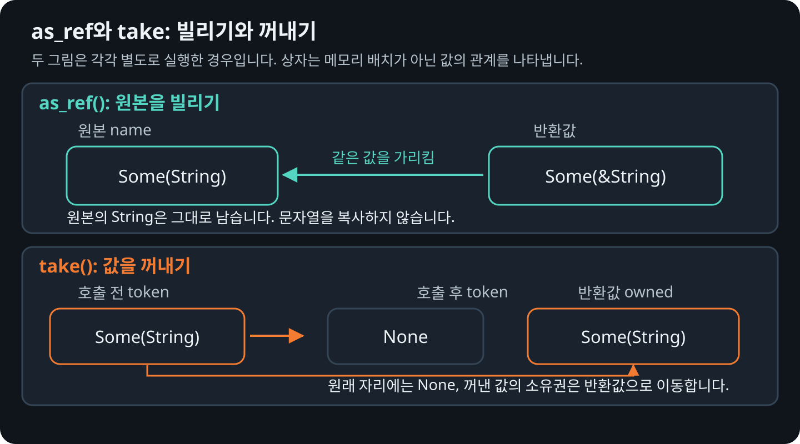

# 참조와 소유권

`Option<String>` 값을 패턴 매칭<sub>pattern matching</sub>으로 분해하면 안에 든 `String`의 소유권이 이동할 수
있습니다. `as_ref`를 사용하면 `&Option<T>`를 `Option<&T>`로 바꾸어, 원본의 소유권을
옮기지 않고 안의 값을 읽을 수 있습니다.

```rust
{{#rustdoc ../../../examples/04_borrowing.rs body=borrow}}
```

`len()`은 글자 수가 아닌 UTF-8 바이트 수를 반환합니다. “러스트”는 한글 세 글자가
각각 3바이트이므로 `length`는 `Some(9)`입니다. `as_ref`로 빌려서 읽었으므로
`name`에는 여전히 `Some(String::from("러스트"))`가 남아 있습니다.

`as_mut`를 쓰면 소유권을 유지한 채 안의 값을 바꿀 수 있습니다. `take`는 안의
값을 꺼내고 그 자리에 `None`을 남깁니다.

```rust
{{#rustdoc ../../../examples/04_borrowing.rs body=take}}
```

## 빌리기와 꺼내기의 차이

<figure>
  
  <figcaption>as_ref는 원본을 빌리고, take는 원본의 값을 꺼냅니다.</figcaption>
</figure>

## 빌려서 수정하기

```rust
{{#rustdoc ../../../examples/04_borrowing.rs body=mutate}}
```

`as_mut`로 얻은 수정 가능한 참조 `value`를 통해 “러스트” 뒤에 `!`를 붙입니다.
문자열의 소유권을 꺼내지 않고 원본을 수정하므로, `name`은
`Some(String::from("러스트!"))`가 됩니다.

## 대기 중인 작업을 한 번만 꺼내 처리하기

`take`는 보관 중인 값을 복사 없이 꺼내 쓰고, 원래 자리에는 `None`을 남기고
싶을 때 사용합니다. 예를 들어 대기 중인 작업을 한 번만 가져와 처리할 수 있습니다.

```rust
{{#rustdoc ../../../examples/04_borrowing.rs item=Worker..impl:Worker}}
```

`pending`에 `Some(String::from("메일 보내기"))`가 들어 있다고 해 봅시다.
첫 번째 `run()`은 `take()`로 작업의 소유권을 가져오면서 `pending`을 `None`으로
바꾼 뒤, “작업 처리: 메일 보내기”를 출력합니다. 다시 `run()`을 호출하면
대기 중인 작업이 없으므로 아무 일도 하지 않습니다.

여기서는 `self`를 `&mut self`로 빌린 상태입니다. 빌린 구조체의 `String` 값을
그냥 옮겨 꺼내면 원래 자리에 값이 없어지므로 허용되지 않습니다. `take()`는
그 자리에 유효한 값인 `None`을 넣어 주기 때문에, 구조체를 유지하면서 안의 값의
소유권을 가져올 수 있습니다. 꺼낸 작업은 소유권이 필요한 다른 함수에 넘길 수도 있습니다.

단순히 읽으려면 `as_ref`, 안의 값을 수정하려면 `as_mut`, 꺼내서 넘기거나
소비하려면 `take`를 사용합니다.
