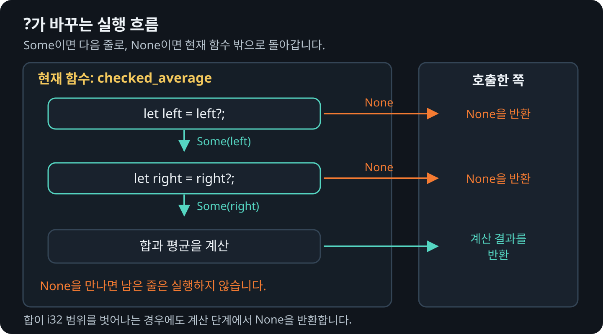

# `?`와 `Option`을 반환하는 함수

`Option`을 반환하는 함수에서 `?`를 사용하면 `Some`에서 값을 꺼낼 수 있습니다.
값이 `None`이면 뒤의 코드를 실행하지 않고 함수에서 바로 `None`을 반환합니다.

## match로 일찍 반환하기

```rust
{{#rustdoc ../../../examples/05_question_mark.rs item=half_sum_with_match}}
```

## 같은 흐름을 ?로 줄이기

```rust
{{#rustdoc ../../../examples/05_question_mark.rs item=checked_average}}
```

## 함수 안에서 계속할 때와 바로 끝낼 때

<figure>
  
  <figcaption>?는 반복문을 빠져나가는 것이 아니라 현재 함수에서 반환합니다.</figcaption>
</figure>

값이 없는 상태를 오류로 다뤄야 한다면 `ok_or` 또는 `ok_or_else`로 `Result`로
바꿉니다.

이 함수는 정수 평균을 계산하므로 소수 부분은 버립니다. 두 값을 더한 결과가 `i32` 범위를
벗어나면 `None`을 반환합니다. 평균은 범위 안에 들어오더라도, 합을 구하는 단계에서
범위를 벗어나면 계산을 멈춥니다.
