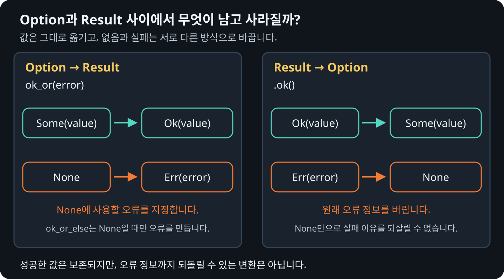

# `Option`과 `Result` 변환하기

어느 타입을 쓸지 정할 때는 함수를 호출하는 쪽에서 실패 이유까지 알아야 하는지
생각해 보세요.

| 상황 | 반환 타입 | 예시 |
| --- | --- | --- |
| 값이 없어도 정상적인 결과 | `Option<T>` | 검색한 사용자가 없으면 `None` |
| 실패 이유를 알려야 함 | `Result<T, E>` | 포트 설정을 숫자로 바꾸지 못하면 `Err` |
| 값이 없어도 괜찮지만, 있으면 올바른 값이어야 함 | `Result<Option<T>, E>` | 포트 설정 없음은 `Ok(None)`, 잘못된 설정은 `Err` |

## 값이 없는 경우를 오류로 바꾸기

`ok_or`/`ok_or_else`는 `None`일 때 반환할 오류를 지정해 `Option`을 `Result`로
바꿉니다.

```rust
{{#rustdoc ../../../examples/13_option_result.rs item=required_port}}
```

## 오류 내용을 버리고 값만 남기기

실패 이유는 필요 없고 성공한 값이 있는지만 확인하려면 `Result`의 `.ok()`를
사용합니다. `Ok(value)`는 `Some(value)`로, `Err(error)`는 `None`으로 바뀝니다.

다음 함수는 문자열을 포트 번호로 바꾸고, 변환에 실패하면 이유를 구분하지 않고
`None`을 반환합니다. `parse::<u16>()`의 결과는 `Result<u16, ParseIntError>`이고,
여기에 `.ok()`를 호출한 결과는 `Option<u16>`입니다.

```rust
{{#rustdoc ../../../examples/13_option_result.rs item=parse_port}}

{{#rustdoc ../../../examples/13_option_result.rs body=discard_error}}
```

`"rust"`는 숫자가 아니고 `"65536"`은 `u16`의 범위를 벗어나지만, 변환한 뒤에는
둘 다 `None`이므로 실패 이유를 알 수 없습니다. 호출하는 쪽에서 원인을 구분하거나
오류 메시지를 보여 줘야 한다면 `.ok()`로 바꾸지 않고 `Result`를 유지하세요.

## 두 타입 사이의 변환 흐름

<figure>
  
  <figcaption>ok_or는 없던 오류 정보를 지정하고, .ok()는 원래 오류 정보를 버립니다.</figcaption>
</figure>

## 변환하면서 남기거나 버리는 정보

| 호출 | 입력 | 결과 | 오류 정보 |
| --- | --- | --- | --- |
| `ok_or(error)` | `Some(value)` | `Ok(value)` | 넘긴 오류는 사용하지 않음 |
| `ok_or(error)` | `None` | `Err(error)` | 호출하는 쪽에서 오류를 지정 |
| `.ok()` | `Ok(value)` | `Some(value)` | 원래 오류가 없음 |
| `.ok()` | `Err(error)` | `None` | 원본 오류를 버림 |

`ok_or_else`도 변환 결과는 같습니다. 다만 오류를 만드는 함수는 `None`일 때만
실행합니다. `ok_or`에 넘기는 오류 값은 메서드를 호출하기 전에 계산합니다.

다음 장에서는 이 변환을 이용해 [함수의 반환 타입에 맞춰 `?`를 사용하는 방법](./14-question-mark.md)을 살펴봅니다.
