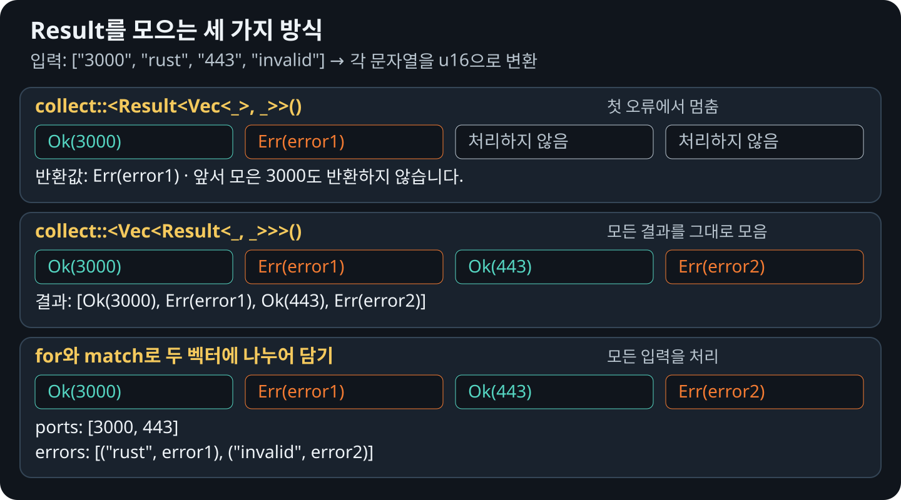

# 반복자와 일괄 처리

`collect::<Result<Vec<_>, _>>()`는 모든 항목이 `Ok`일 때 그 안의 값을 하나의 `Vec`로
모읍니다. 처음 `Err`를 만나면 나머지 항목은 처리하지 않고 그 오류를 반환합니다.

## 모두 성공하면 값을 모으기

모든 문자열을 포트 번호로 바꿀 수 있으면, 각 변환 결과는 `Ok(포트 번호)`입니다.
`collect`는 각각의 `Ok` 안에서 값을 꺼내 입력 순서대로 모은 뒤,
전체 벡터를 하나의 `Ok`로 감싸 반환합니다.

```rust
{{#rustdoc ../../../examples/11_result_iterators.rs item=use:std::num::ParseIntError}}

{{#rustdoc ../../../examples/11_result_iterators.rs body=collect_successes}}
```

결과는 `Ok(vec![3000, 8080, 443])`입니다. `Vec<Result<u16, ParseIntError>>`처럼
각 항목에 `Ok`가 남는 형태가 아니라, `Result<Vec<u16>, ParseIntError>`가 됩니다.
예제에서는 `ports`의 타입을 지정했기 때문에 `collect()`가 이 방식으로 값을 모읍니다.

## 처음 실패하면 멈추기

```rust
{{#rustdoc_include ../../../examples/11_result_iterators.rs:3:14}}
```

`visited`를 보면 마지막 입력인 `"443"`은 처리하지 않았음을 알 수 있습니다.
앞서 변환에 성공한 포트 번호도 최종 반환값에는 포함되지 않습니다.

## 성공과 실패를 그대로 모으기

결과 타입을 `Vec<Result<u16, ParseIntError>>`로 지정하면 `Ok`와 `Err`를
그대로 하나의 벡터에 모읍니다. 중간에 `Err`가 나와도 멈추지 않고 마지막 입력까지
처리하며, 결과는 입력 순서대로 담깁니다.

```rust
{{#rustdoc ../../../examples/11_result_iterators.rs item=use:std::num::ParseIntError}}

{{#rustdoc ../../../examples/11_result_iterators.rs item=collect_results}}
```

`collect()`가 항상 첫 오류에서 멈추는 것은 아닙니다.
`Result<Vec<_>, _>`가 아니라 `Vec<Result<_, _>>`로 모으면 각 항목의 성공과
실패를 모두 남길 수 있습니다. 이처럼 그대로 모으는 데에는 `for`문이 필요하지 않습니다.

## 성공한 값과 실패한 입력을 나누어 모으기

```rust
{{#rustdoc ../../../examples/11_result_iterators.rs item=separate_results}}
```

이 예제는 성공한 포트 번호를 `ports`에, 실패한 입력과 오류를 `errors`에 나누어
담습니다. `for`와 `match`는 각 결과를 어느 벡터에 넣을지 분명하게 보여 줍니다.
오류를 모두 모으기 위해 반드시 `for`문을 써야 하는 것은 아닙니다.

## 세 처리 방식 비교하기

<figure>
  
  <figcaption>처음 오류에서 멈출지, 모든 결과를 그대로 모을지, 성공과 실패를 나누어 담을지 결정합니다.</figcaption>
</figure>
